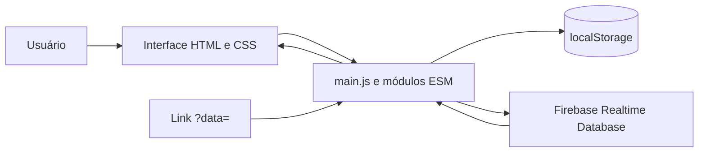

# Lista de Compras

Aplicação web estática para organizar compras por item, preço unitário, quantidade e unidade. A lista funciona localmente no navegador e pode ser compartilhada por uma sala pública do Firebase Realtime Database ou, como alternativa técnica, por um link com snapshot em `?data=`.

- **Produção:** [https://kaiolopes02.github.io/Lista-de-Itens/](https://kaiolopes02.github.io/Lista-de-Itens/)
- **Projeto Firebase:** `lista-de-itens-2a16b`
- **Status:** publicado no GitHub Pages, com o Realtime Database usado no modo de salas compartilhadas.

> O manifesto habilita a instalação da aplicação em navegadores compatíveis, mas o projeto **não possui service worker**. Portanto, não há garantia de funcionamento offline completo. A configuração Web do Firebase é carregada por CDN.

## Índice

- [Funcionalidades](#funcionalidades)
- [Arquitetura](#arquitetura)
- [Estrutura do projeto](#estrutura-do-projeto)
- [Fluxos principais](#fluxos-principais)
- [Persistência e modelo de dados](#persistência-e-modelo-de-dados)
- [Firebase](#firebase)
- [Execução local](#execução-local)
- [Deploy](#deploy)
- [Verificação](#verificação)
- [Segurança](#segurança)
- [Limitações](#limitações)
- [Próximos passos](#próximos-passos)

## Funcionalidades

- **Gerenciamento de itens:** adicionar, editar e excluir itens; nomes duplicados são recusados, sem diferenciar maiúsculas de minúsculas.
- **Unidades:** `un` para unidades e `kg` para peso. Na tela, pesos menores que 1 kg são exibidos em gramas.
- **Conclusão de itens:** marcar ou desmarcar um item individualmente e marcar ou desmarcar todos em massa.
- **Ordenação:** por nome em ordem alfabética ou pelos itens mais recentes. A ordem por data usa o `id` numérico, gerado com `Date.now()`.
- **Totais:** quantidade incluída, separada entre `un` e `kg`, contagem de itens marcados, valor total da compra e barra de progresso. O progresso representa a proporção de **itens** incluídos, não a soma das quantidades.
- **Histórico local:** até 5 compras finalizadas, com data, itens, tema e totais; cada compra pode ser removida individualmente.
- **Temas:** 9 paletas — Azul, Verde, Violeta, Vermelho, Laranja, Amarelo, Anil, Rosa e Escuro.
- **Compartilhamento:** criação de sala no Firebase ou, quando o Firebase não está configurado, fallback de snapshot no parâmetro `?data=`.
- **Instalação:** `site.webmanifest` define nome, modo `standalone` e ícones de 192 e 512 pixels. Não há cache de aplicação ou suporte offline completo.

### Onde os dados ficam

| Cenário | Dados compartilhados | Persistência |
|---|---|---|
| Uso local | Lista atual e tema | `localStorage`, por navegador e origem |
| Sala Firebase | Lista atual e tema | `listas/$salaId` no Realtime Database; a sala é pública para quem conhece o identificador |
| Link `?data=` | Snapshot da lista e do tema | Dentro da própria URL; não há cópia no servidor, mas o conteúdo fica visível para quem recebe o link |

O histórico de compras não é enviado ao Firebase e não acompanha o link `?data=`; ele permanece local no dispositivo.

## Arquitetura

### Stack

| Camada | Tecnologia |
|---|---|
| Interface | HTML5 semântico e CSS3 responsivo |
| Aplicação | JavaScript com módulos ESM nativos, sem framework |
| APIs do navegador | DOM, `localStorage`, `URLSearchParams`, `Intl`, Web Share API e Clipboard API, quando disponíveis |
| Persistência local | `localStorage` |
| Sincronização | Firebase Realtime Database Web SDK 10.12.2, carregado da CDN oficial |
| Hospedagem | GitHub Pages, no subcaminho `/Lista-de-Itens/` |

Não há bundler, etapa de build, gerenciador de pacotes ou dependência de runtime empacotada no repositório. Os módulos JavaScript e CSS são carregados diretamente pelo navegador. O SDK do Firebase e a fonte Outfit são recursos externos da CDN.

### Visão geral



O navegador carrega `index.html`, que registra os eventos e importa os módulos ESM. O estado em memória é atualizado pelos módulos, salvo em `localStorage` e, quando existe uma sala ativa, publicado no Firebase. As alterações remotas retornam ao mesmo estado e são renderizadas novamente na interface.

## Estrutura do projeto

```text
.
├── index.html
├── site.webmanifest
├── firebase.json
├── database.rules.json
├── assets/
│   ├── icon-192.png
│   └── icon-512.png
├── css/
│   ├── style.css
│   ├── base.css
│   ├── layout.css
│   ├── components.css
│   ├── notificacao.css
│   └── tema.css
├── js/
│   ├── main.js
│   ├── itens.js
│   ├── lista.js
│   ├── storage.js
│   ├── sync.js
│   ├── historico.js
│   ├── tema.js
│   ├── notificacao.js
│   └── icones.js
├── docs/superpowers/
├── security-audit/
│   ├── run-1/REPORT.md
│   └── run-2/REPORT.md
└── README.md
```

### Módulos JavaScript

| Módulo | Responsabilidade |
|---|---|
| `js/main.js` | Inicialização, registro de eventos, edição, compartilhamento, carregamento de `?sala=` ou `?data=` e interface entre os demais módulos |
| `js/itens.js` | CRUD, validação do formulário, alternância individual e em massa, limpeza e modo de edição |
| `js/lista.js` | Renderização dos itens, escape de nomes, formatação de valores, totais, progresso e ordenações |
| `js/storage.js` | Estado em memória, persistência local, validação mínima de estado externo e histórico de compras |
| `js/sync.js` | Configuração do Firebase, criação e entrada em salas, publicação do estado e observação de atualizações remotas |
| `js/historico.js` | Modal de histórico, formatação de datas e totais e remoção de compras salvas |
| `js/tema.js` | Definição das 9 paletas, seleção, aplicação e persistência do tema |
| `js/notificacao.js` | Toast temporário com variantes de sucesso, erro e informação |
| `js/icones.js` | Ícones SVG inline e injeção dos elementos gráficos na interface |

### Módulos CSS

| Módulo | Responsabilidade |
|---|---|
| `css/style.css` | Entrada do estilo; importa a fonte e os módulos CSS na ordem correta |
| `css/base.css` | Reset, variáveis, tipografia, fundo global e suporte à redução de movimento |
| `css/layout.css` | Container principal, cards, cabeçalho, totais, barra de progresso e lista de itens |
| `css/components.css` | Botões, formulário, modal de temas, modal de histórico e ajustes de ícones |
| `css/notificacao.css` | Toast flutuante e seus estados visuais |
| `css/tema.css` | Variáveis das 9 paletas e regras de responsividade |

## Fluxos principais

### Inicialização

1. Em `DOMContentLoaded`, os ícones SVG são injetados no HTML.
2. Se o Firebase estiver configurado, o SDK e o Realtime Database são inicializados.
3. A URL é verificada: `?sala=` abre uma sala existente; sem sala válida, `?data=` tenta aplicar um snapshot; sem nenhum deles, o estado local é carregado.
4. O tema salvo é aplicado, a lista é renderizada e os totais são calculados.
5. Os controles do cabeçalho, formulário, lista, modais e notificações registram seus eventos.

### CRUD e alterações locais

1. O formulário valida nome, preço, quantidade e unidade.
2. A criação usa `id` numérico baseado em `Date.now()`; a edição preserva o `id` existente.
3. A lista e os totais são re-renderizados.
4. O estado completo é salvo em `localStorage`.
5. Se houver uma sala ativa, o estado completo é publicado no Firebase.

Excluir um item remove-o imediatamente do estado; a animação de saída é apenas visual. A conclusão de compra limpa a lista e a sincroniza quando existe uma sala.

### Histórico

1. “Finalizar compra” exige confirmação e uma lista não vazia.
2. Uma cópia da lista atual, com data e tema, é inserida no início do histórico.
3. O histórico é limitado a 5 registros; o mais antigo é removido.
4. A lista atual fica vazia e é salva e sincronizada.
5. O modal permite consultar e excluir cada entrada.

### Tema

A seleção altera `data-tema` no elemento raiz, atualiza o estado e persiste em `localStorage`. O tema integra o payload de estado usado pelo Firebase e pelo fallback `?data=`. A seleção de tema, isoladamente, não dispara uma publicação imediata no Firebase; a propagação para uma sala pode ocorrer em uma publicação posterior da lista.

### Compartilhamento

1. A aplicação gera um resumo textual com itens, quantidades, subtotais e total.
2. Com Firebase configurado, cria uma sala de 6 caracteres ou reutiliza a sala ativa e gera um link `?sala=<id>`.
3. Sem Firebase configurado, serializa lista e tema em Base64 e gera um link `?data=<payload>`.
4. Usa a Web Share API quando disponível; caso contrário, tenta copiar o resumo e o link pela Clipboard API.

### Atualização remota

Ao entrar em uma sala, `onValue` observa `listas/$salaId`. O cliente ignora o eco de sua própria publicação quando lista e tema são idênticos. Uma alteração remota passa por `aplicarEstadoExterno`, é salva localmente e provoca nova renderização.

A publicação usa `set` no caminho da sala com `itens`, `temaAtual` e `ts`. Como cada cliente publica o estado inteiro, a última escrita prevalece (**last-write-wins**). O campo `ts` é registrado, mas não é usado para mesclar nem para resolver conflitos.

## Persistência e modelo de dados

### Chaves locais

| Chave | Conteúdo | Limite |
|---|---|---|
| `listaCompras_v2` | Lista atual e tema | Uma entrada por navegador/origem |
| `listaCompras_historico` | Compras finalizadas | 5 entradas |

Na inicialização, o código ainda lê a chave legada `listaCompras` se `listaCompras_v2` não existir; as novas gravações usam `listaCompras_v2`.

### Item da lista

| Campo | Tipo | Regras no cliente e nas regras do Firebase |
|---|---|---|
| `id` | Número | Identificador gerado por `Date.now()` |
| `nome` | Texto | Nome não vazio; no RTDB, entre 1 e 120 caracteres |
| `preco` | Número | Preço por unidade, maior ou igual a zero |
| `quantidade` | Número | Quantidade maior que zero |
| `unidade` | Texto | `un` ou `kg` |
| `incluido` | Booleano | Indica se o item está marcado na compra |

O estado completo em `localStorage` tem a forma `{ "itens": [], "temaAtual": "azul" }`. Uma entrada do histórico acrescenta `id`, `data`, `itens` e `temaAtual`.

### Entradas externas

`aplicarEstadoExterno` é o ponto comum para dados do Firebase e de `?data=`. Ele descarta itens sem `id` numérico ou sem `nome` textual não vazio e aceita um `temaAtual` textual. Essa validação de cliente é mínima: ela **não** valida preço, quantidade, unidade ou `incluido`. As escritas diretas no Firebase também passam pelas Security Rules, que são mais restritivas, mas um snapshot `?data=` pode ser aberto sem passar por essas regras.

## Firebase

O app Web está configurado em `js/sync.js` para o projeto `lista-de-itens-2a16b`, com banco em `https://lista-de-itens-2a16b-default-rtdb.firebaseio.com`.

A `apiKey` do Firebase Web não é um segredo: ela identifica o projeto e não concede acesso sozinha. A proteção dos dados depende das Realtime Database Security Rules e das permissões do projeto. O código atual **não usa Firebase Authentication**.

### Regras do Realtime Database

`database.rules.json` define:

- leitura e escrita anônimas apenas em `listas/$salaId`;
- validação dos campos presentes de cada item: `id`, `nome`, `preco`, `quantidade`, `unidade` e `incluido`;
- `nome` entre 1 e 120 caracteres, `preco` maior ou igual a zero, `quantidade` maior que zero, `unidade` em `un` ou `kg` e `incluido` booleano;
- validação de `temaAtual` como texto de até 32 caracteres e de `ts` como número;
- rejeição de campos desconhecidos com `$other`;
- bloqueio de leitura e escrita no restante da raiz.

As regras validam campos presentes, mas não usam `.require` para exigir todos eles. O cliente, por outro lado, publica todos os campos do modelo normal.

### Configuração de publicação

`firebase.json` contém somente o target do Realtime Database:

```json
{
  "database": {
    "rules": "database.rules.json"
  }
}
```

Esse arquivo permite que o Firebase CLI encontre as regras versionadas; ele não configura Hosting, Storage ou Functions.

### Acesso às salas

Uma sala é um identificador curto, normalmente de 6 caracteres, gerado no cliente. O parâmetro `?sala=` aceita de 2 a 64 caracteres alfanuméricos, `_` e `-`.

As regras permitem leitura e escrita anônimas dentro de uma sala. Assim, **quem tiver o identificador da sala pode consultar e alterar seu estado**. Não existe propriedade de sala, autenticação ou segregação por usuário. O identificador reduz acesso acidental, mas não elimina o risco de acesso indevido ou IDOR anônimo.

## Execução local

Pré-requisitos: Python 3 para servir os arquivos e um navegador moderno. Não é necessário instalar dependências do projeto.

Na raiz do repositório, execute:

```powershell
python -m http.server 8765
```

Abra `http://127.0.0.1:8765/` no navegador.

> Não abra `index.html` diretamente por `file://`. Os módulos ESM e as importações do Firebase exigem um contexto HTTP. Como o SDK do Firebase é importado estaticamente por CDN, uma rede indisponível pode impedir o carregamento do grafo de módulos.

O `localStorage` usado no teste local é separado do `localStorage` da origem de produção. O manifesto aponta `start_url` para `/Lista-de-Itens/`, caminho usado pelo GitHub Pages; a execução em `127.0.0.1` é destinada ao desenvolvimento, não à simulação completa da hospedagem pública.

## Deploy

### Publicar as regras do Firebase

Com o Firebase CLI autenticado e o projeto correto selecionado, publique apenas o target RTDB:

```powershell
firebase deploy --only database --project lista-de-itens-2a16b
```

O comando usa `firebase.json` e publica o conteúdo de `database.rules.json`. Não há build do site para essa etapa.

### Publicar o site no GitHub Pages

O repositório publica a raiz do branch `master` no subcaminho `/Lista-de-Itens/`. Depois da revisão e das verificações do branch, o fluxo de publicação usa um push explícito para esse branch:

```powershell
git push origin chore/readme-deploy:master
```

Não há bundler nem artefato de build: os arquivos versionados em `index.html`, `css/`, `js/`, `assets/` e `site.webmanifest` são publicados diretamente.

## Verificação

Os comandos abaixo reproduzem as verificações locais usadas antes de uma publicação.

### Sintaxe dos nove módulos ESM

O projeto não possui um manifesto de pacotes. Para que o Node.js trate cada arquivo como módulo, copie os nove arquivos para um diretório temporário com extensão `.mjs` e execute `node --check` em cada cópia:

```powershell
$temp = Join-Path $env:TEMP "lista-esm-$([guid]::NewGuid().ToString('N'))"
New-Item -ItemType Directory -Path $temp | Out-Null
try {
  Get-ChildItem js -Filter '*.js' | ForEach-Object {
    $copy = Join-Path $temp ($_.BaseName + '.mjs')
    Copy-Item $_.FullName $copy
    node --check $copy
    if ($LASTEXITCODE -ne 0) { throw "Falha sintática em $($_.Name)" }
  }
  Write-Output '9 módulos ESM válidos.'
} finally {
  Remove-Item $temp -Recurse -Force
}
```

### JSON

```powershell
'firebase.json', 'database.rules.json', 'site.webmanifest' |
  ForEach-Object { Get-Content $_ -Raw | ConvertFrom-Json -ErrorAction Stop | Out-Null }
```

### HTTP local

Inicie o servidor em um processo:

```powershell
python -m http.server 8765 --bind 127.0.0.1
```

Em outro processo, confirme HTTP 200 para:

| Rota | Conteúdo esperado |
|---|---|
| `/` | `index.html` |
| `/js/main.js` | módulo de entrada ESM |
| `/css/style.css` | entrada dos estilos |
| `/site.webmanifest` | manifesto da aplicação |
| `/assets/icon-192.png` | ícone de 192 pixels |
| `/assets/icon-512.png` | ícone de 512 pixels |

### Renderização em Chrome headless

O redirecionamento por `cmd.exe` evita captura inconsistente da saída do Chrome pelo PowerShell:

```powershell
$id = [guid]::NewGuid().ToString('N')
$profile = Join-Path $env:TEMP "opencode-chrome-$id"
$out = Join-Path $env:TEMP "opencode-chrome-$id.out"
$err = Join-Path $env:TEMP "opencode-chrome-$id.err"
$command = '"C:\Program Files\Google\Chrome\Application\chrome.exe" --headless --disable-gpu --no-first-run --no-default-browser-check --user-data-dir="' + $profile + '" --dump-dom "http://127.0.0.1:8765/" > "' + $out + '" 2> "' + $err + '"'
cmd.exe /d /c $command
$html = Get-Content $out -Raw
if ($html -notmatch '<title>Lista de Compras</title>') { throw 'título ausente' }
if ($html -notmatch 'Lista vazia!') { throw 'estado vazio não renderizado' }
if ($html -notmatch '<svg[^>]+aria-hidden="true"') { throw 'ícones não injetados' }
```

O resultado esperado é título, estado vazio e SVG injetado no DOM.

### Payload externo malformado

Gere o snapshot Base64 abaixo e abra-o em um perfil Chrome headless separado:

```powershell
$json = '{"itens":[{"nome":"ItemInvalido999"}]}'
$payload = [Convert]::ToBase64String([Text.Encoding]::UTF8.GetBytes($json))
$url = "http://127.0.0.1:8765/?data=$payload"
```

O item não possui `id` numérico e deve ser descartado por `aplicarEstadoExterno`. O DOM esperado continua contendo `Lista vazia!`, não contém `ItemInvalido999` e não apresenta erro fatal de renderização.

### Sala descartável do Release Gate

Use a URL do banco e um identificador aleatório no formato `verify-<timestamp>-<random>`. O script abaixo executa as quatro verificações e mantém o `DELETE` no `finally`, portanto a limpeza é tentada mesmo quando uma asserção falha:

```powershell
$base = 'https://lista-de-itens-2a16b-default-rtdb.firebaseio.com'
$id = "verify-$([DateTimeOffset]::UtcNow.ToUnixTimeSeconds())-$([guid]::NewGuid().ToString('N').Substring(0,8))"
$room = "$base/listas/$id.json"

function Invoke-Rtdb([string]$Method, [string]$Uri, [string]$Body = '') {
  $params = @{ Method = $Method; Uri = $Uri; UseBasicParsing = $true }
  if ($Body) { $params.Body = $Body; $params.ContentType = 'application/json' }
  try {
    $response = Invoke-WebRequest @params
    return [pscustomobject]@{ Status = [int]$response.StatusCode; Body = $response.Content }
  } catch {
    if (-not $_.Exception.Response) { throw }
    return [pscustomobject]@{ Status = [int]$_.Exception.Response.StatusCode; Body = $_.ErrorDetails.Message }
  }
}

function Assert-Status($Response, [int[]]$Expected, [string]$Step) {
  if ($Response.Status -notin $Expected) {
    throw "${Step}: HTTP $($Response.Status), esperado $($Expected -join '/')"
  }
}

$valid = @{ itens = @(@{ id = 1; nome = 'Item de verificação'; preco = 1; quantidade = 1; unidade = 'un'; incluido = $true }); temaAtual = 'azul'; ts = 1 } | ConvertTo-Json -Depth 5 -Compress
$invalid = @{ itens = @(@{ id = 2; nome = 'Item inválido'; preco = -1; quantidade = 1; unidade = 'un'; incluido = $true; extra = 'bloqueado' }); temaAtual = 'azul'; ts = 2 } | ConvertTo-Json -Depth 5 -Compress

try {
  $response = Invoke-Rtdb PUT $room $valid
  Assert-Status $response @(200) 'PUT válido'
  $response = Invoke-Rtdb GET $room
  Assert-Status $response @(200) 'GET da sala'
  if ($response.Body -notmatch 'Item de verificação') { throw 'GET da sala: payload não persistido' }
  $response = Invoke-Rtdb PUT $room $invalid
  Assert-Status $response @(400) 'PUT inválido'
  $response = Invoke-Rtdb GET "$base/.json"
  Assert-Status $response @(401) 'GET da raiz'
} finally {
  $cleanup = Invoke-Rtdb DELETE $room
  Assert-Status $cleanup @(200) 'DELETE de limpeza'
}

$response = Invoke-Rtdb GET $room
Assert-Status $response @(200) 'GET após limpeza'
if ($response.Body.Trim() -ne 'null') { throw 'Sala descartável ainda contém dados' }
```

O teste valida as regras ativas, não apenas o arquivo local. Se o `DELETE` de limpeza falhar, o comando termina com erro e a sala deve ser removida manualmente.

## Segurança

Os relatórios das duas auditorias executadas estão em `security-audit/run-1/REPORT.md` e `security-audit/run-2/REPORT.md`. Eles registram correções e riscos residuais; não são uma garantia absoluta de segurança.

### Controles presentes

- **Escape de conteúdo:** nomes são escapados antes da renderização da lista e do histórico; o identificador exibido da sala também é escapado.
- **Validação de estado externo:** `aplicarEstadoExterno` filtra itens sem `id` numérico ou `nome` textual não vazio, tanto no caminho Firebase quanto no fallback `?data=`.
- **Validação da chave da sala:** `entrarSala` aceita apenas `^[A-Za-z0-9_-]{2,64}$`, impedindo que a URL monte caminhos Firebase inesperados.
- **Schema no RTDB:** as regras limitam o acesso à árvore `listas`, validam tipos e limites dos campos e rejeitam chaves extras.
- **Falha de persistência:** falhas do `localStorage` são capturadas e mostradas no console, sem interromper silenciosamente a interface.

### Riscos residuais

- **Acesso anônimo e IDOR:** qualquer pessoa que descubra um `salaId` pode ler, alterar ou apagar aquela sala. Não há proprietário, autenticação nem segregação por participante.
- **Conflitos:** `set` substitui o estado inteiro. Edições simultâneas podem sobrescrever trabalho anterior; o modelo é **last-write-wins**, sem lock, transação ou merge por item.
- **Validação externa parcial:** o filtro do cliente garante apenas `id` e `nome`; os demais campos de um snapshot `?data=` ainda precisam de validação antes de uso seguro.
- **Chave pública do Firebase:** a `apiKey` é pública por natureza e não deve ser tratada como credencial secreta. As regras e as permissões do projeto são o controle relevante.
- **Link contém dados:** um snapshot `?data=` pode ser registrado em histórico, proxy ou logs de navegador. Ele não oferece sigilo.
- **Sem Content Security Policy:** `index.html` não define CSP. Também não há observabilidade, alertas ou registro central de tentativas de acesso.
- **Dependências externas:** SDK do Firebase e Google Fonts são carregados por CDN, o que amplia a superfície de dependências e exige política de atualização e CSP compatível.

## Limitações

- **Sem Firebase Authentication:** salas e participantes não têm identidade; o acesso anônimo é intencional no desenho atual.
- **Sem operações offline completas:** não há fila de alterações, resolução de conflitos ou cache da aplicação. Sem service worker, não há garantia de carregamento ou uso offline.
- **Sem service worker:** o manifesto cobre instalação, mas não cache nem estratégia de atualização do app.
- **Sem testes automatizados:** o projeto não possui suíte unitária, de integração, end-to-end ou de regressão.
- **Sem CI/CD:** validação e publicação são passos manuais.
- **Sem analytics:** não há métricas de uso, erros ou auditoria de eventos.
- **Sem página 404 customizada:** rotas inexistentes dependem do comportamento padrão do GitHub Pages.
- **Histórico local por dispositivo:** compras finalizadas não são sincronizadas e podem ser perdidas ao limpar dados do navegador ou trocar de dispositivo.
- **Sem licença definida:** não há arquivo de licença ou termos de uso explícitos no repositório.
- **Firebase Web SDK dependente de CDN:** o SDK 10.12.2 e a fonte externa são resolvidos em tempo de execução.
- **Sem resolução de conflitos:** alterações simultâneas na mesma sala podem perder dados.
- **Tema não publica imediatamente:** trocar o tema não dispara, por si só, uma escrita no Firebase.

## Próximos passos

A ordem abaixo prioriza primeiro a redução de risco e a qualidade de manutenção; recursos de produto vêm depois das garantias básicas.

| Prioridade | Tipo | Melhoria | Motivo |
|---|---|---|---|
| 1 | Corrigir risco de segurança | Adotar Firebase Authentication e vincular salas a um proprietário ou aos participantes autorizados | Elimina o IDOR anônimo e permite regras por identidade |
| 2 | Corrigir qualidade | Criar testes automatizados unitários, de integração, headless e de segurança | Preserva as correções existentes e detecta regressões |
| 3 | Evoluir resiliência | Implementar service worker com estratégia de cache e invalidação explícita | Oferece carregamento offline controlado, sem prometer sincronização offline que o backend não suporta |
| 4 | Corrigir operação | Adicionar CI/CD para sintaxe, JSON, smoke test, regras e publicação | Torna o Release Gate repetível e reduz publicação manual |
| 5 | Evoluir concorrência | Migrar de `set` integral para atualizações por item ou transações com lock | Reduz perda de dados em edições simultâneas |
| 6 | Corrigir hardening | Definir CSP compatível com as CDNs e adicionar observabilidade, alertas e auditoria | Melhora defesa e resposta a incidentes |
| 7 | Corrigir publicação e jurídico | Criar página 404 customizada e definir licença/termos de uso | Completa a experiência pública e esclarece uso do código |

### Corrigir ou evoluir?

- **Corrigir** Authentication, testes, CI/CD, CSP, observabilidade, 404 e licenciamento fecham riscos ou lacunas operacionais existentes.
- **Evoluir** service worker/offline e transações ou lock ampliam as capacidades, mas exigem um modelo explícito de cache e resolução de conflitos para não contradizer as limitações atuais.
